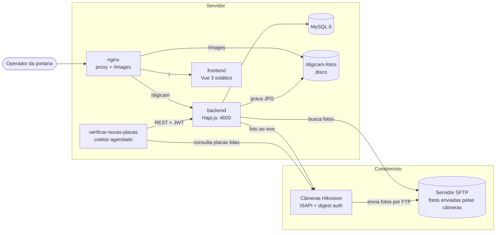
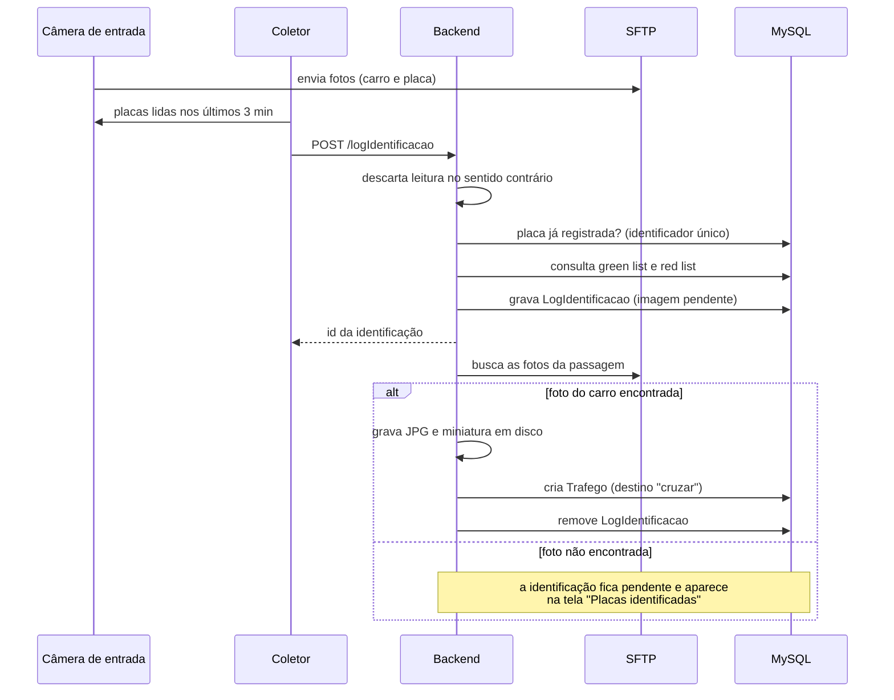
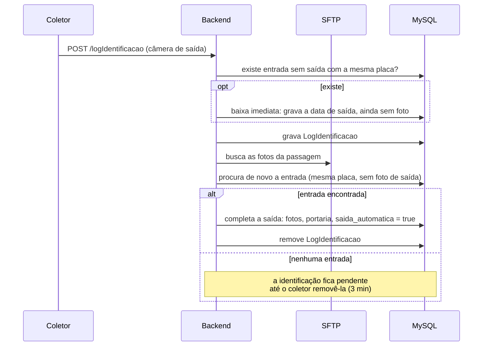
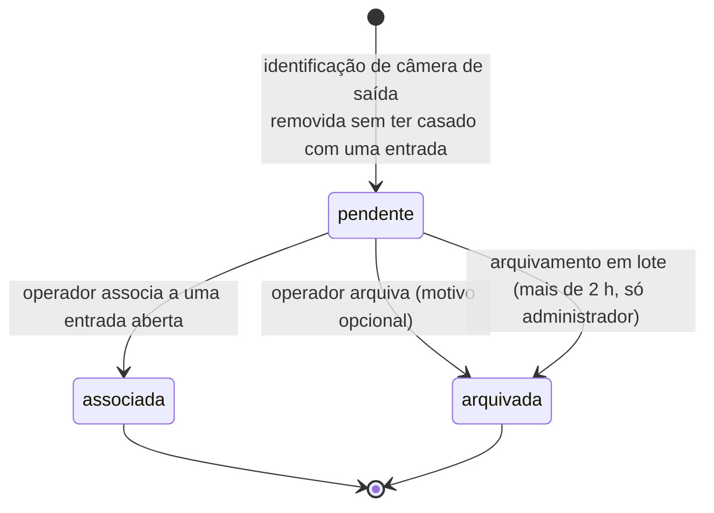
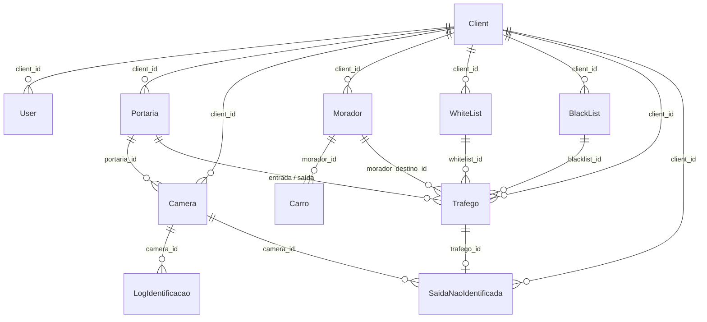

# DigiCAM — Arquitetura, modelo de dados e regras de negócio

Documento de referência do sistema de controle de acesso por leitura de placas (LPR) usado em condomínios.
Descreve o que existe no código deste repositório: serviços, comunicação entre eles, modelo de dados, regras de
negócio, API, frontend e implantação.

## Sumário

1. [Visão geral](#1-visão-geral)
2. [Serviços](#2-serviços)
3. [Fluxos principais](#3-fluxos-principais)
4. [Modelo de dados](#4-modelo-de-dados)
5. [Regras de negócio](#5-regras-de-negócio)
6. [Autenticação e autorização](#6-autenticação-e-autorização)
7. [API REST](#7-api-rest)
8. [Frontend](#8-frontend)
9. [Armazenamento de imagens](#9-armazenamento-de-imagens)
10. [Configuração](#10-configuração)
11. [Implantação e ambientes](#11-implantação-e-ambientes)
12. [Testes](#12-testes)
13. [Pontos de atenção](#13-pontos-de-atenção)

---

## 1. Visão geral

O condomínio tem portarias com câmeras Hikvision que leem placas. O sistema registra cada veículo que entra,
acompanha quanto tempo ele permanece e fecha o registro quando a câmera de saída lê a mesma placa. O operador da
portaria acompanha tudo em uma tela que se atualiza sozinha e resolve manualmente o que a leitura automática não
conseguiu casar.

O sistema é multi-cliente: cada condomínio é um `Client`, e quase todos os dados pertencem a um cliente.



Características da arquitetura:

- **Um backend monolítico** concentra toda a regra de negócio e é o único que acessa o banco.
- **O coletor de placas não tem estado nem banco**: lê as câmeras e conversa com o backend pela mesma API REST
  que o frontend usa.
- **Não há fila nem mensageria.** A integração é por *polling*: o coletor consulta as câmeras a cada poucos
  segundos, e o frontend consulta o backend a cada 5 segundos.
- **As fotos ficam em disco**, fora do banco, e são servidas direto pelo nginx.

## 2. Serviços

| Serviço | Pasta | Tecnologia | Papel |
|---|---|---|---|
| Backend | `backend/` | Node 16, Hapi 20, Sequelize 6, MySQL | API REST, regras de negócio, gravação das fotos |
| Coletor de placas | `verificar-novas-placas/` | Node 18, node-schedule, axios | Lê as câmeras e envia as placas ao backend |
| Frontend | `frontend/` | Vue 3, Vite, Tailwind | Tela do operador e cadastros |
| Servidor de imagens | `servidor-imagens/` | nginx | Serve as fotos em `/images` |
| Banco | — | MySQL 8.0 | Persistência |
| Proxy | `producao_v1/`, `homologacao/` | nginx | Ponto único de entrada HTTP |

### 2.1 Backend (`backend/`)

Inicialização em `server.js`: conecta ao banco (`database.js`), garante os usuários padrão (`bootstrap.js`) e sobe
a API (`api.js`) na porta 4000, com todas as rotas sob o prefixo `/digicam`.

Organização em camadas:

```
routes/        definição das rotas Hapi, validação Joi e documentação Swagger
controllers/   orquestração dos casos de uso (um por recurso)
services/      regras de negócio, acesso ao banco e integrações externas
models/        modelos Sequelize
migrations/    evolução do schema (sequelize-cli)
middleware/    verificação periódica de saúde do banco
```

- Cada arquivo de rota é uma classe que estende `BaseRoute`; cada método público devolve a definição de uma rota,
  e `api.js` registra todas elas.
- Integrações externas ficam em serviços próprios: `hikVision.service.js` (câmera), `ftp.service.js` (SFTP),
  `file.service.js` (disco), `excel.service.js` (relatório).
- Plugins: `hapi-auth-jwt2` (autenticação), `hapi-swagger` (documentação em `/digicam/docs`), `blipp` (lista as
  rotas no log ao subir), `hapi-dev-errors`.
- O processo encerra de forma ordenada em `SIGTERM`/`SIGINT`: para o servidor e fecha o pool do banco.
- Pool do Sequelize: 5 a 20 conexões, com nova tentativa automática em erros de conexão (`models/index.js`).

### 2.2 Coletor de placas (`verificar-novas-placas/`)

Processo único com um job agendado por expressão cron (`CRON_SCHEDULE`; em produção e homologação,
`*/5 * * * * *`, a cada 5 segundos). A cada execução:

1. Faz login no backend com o usuário de sistema e guarda o token em memória (só na primeira vez).
2. Carrega as câmeras dos clientes listados em `CLIENT_IDS` (só na primeira vez; fica em memória).
3. Para cada câmera, lista as identificações pendentes no backend e **pede a remoção das que têm mais de
   3 minutos**. É essa remoção que alimenta a fila de saídas sem entrada (seção 3.3).
4. Para cada câmera, consulta as placas lidas nos últimos 3 minutos e envia cada uma ao backend
   (`POST /digicam/logIdentificacao`). A mesma placa é enviada várias vezes; o backend descarta as repetidas.

Consulta às câmeras, conforme o modelo cadastrado:

| Modelo | Endpoint ISAPI | Método |
|---|---|---|
| `hikvision-DS-2CD7A26G0/P-IZS` | `/ISAPI/Traffic/channels/101/vehicleDetect/plates` | GET com XML `AfterTime` |
| `hikvision-iDS-2CD7A26G0/P-IZHS` | `/ISAPI/Traffic/vehicleInfoCond` | POST com XML `VehicleInfoCond` |
| iDS, quando o anterior não traz resultado | `/ISAPI/Traffic/channels/1/licensePlateAuditData/record` | GET (JSON) |

De cada leitura são aproveitados: placa, horário da captura, direção (`forward`, `reverse` ou `unknown`) e nome da
foto. Falha em uma câmera devolve lista vazia e não interrompe as demais. `DEBUG_CURL=true` imprime o comando
`curl` equivalente a cada requisição.

### 2.3 Frontend (`frontend/`)

SPA em Vue 3 servida como arquivos estáticos por nginx. Fala com o backend por caminho relativo (`/digicam`) e
carrega as fotos de `/images`. Detalhes na [seção 8](#8-frontend).

### 2.4 Servidor de imagens (`servidor-imagens/`)

Configuração de nginx que expõe a pasta de fotos em `/images`. Nos ambientes com docker-compose (produção e
homologação) esse papel é feito pelo próprio nginx de entrada, que monta a pasta de fotos; o manifesto desta pasta
é da implantação em Kubernetes.

## 3. Fluxos principais

### 3.1 Entrada automática



Toda entrada automática nasce com destino **"cruzar"** (veículo atravessando o condomínio). Se o veículo vai a um
morador ou prestar serviço, o operador edita o registro.

### 3.2 Saída automática



A saída é registrada em dois tempos de propósito: a baixa imediata garante que o veículo não fique "dentro" do
condomínio caso a foto demore ou não chegue; a segunda etapa completa o registro com as fotos.

### 3.3 Saída sem entrada identificada (conciliação manual)

Quando a câmera de saída lê uma placa que não corresponde exatamente a nenhuma entrada aberta — em geral por erro
de OCR em uma das duas leituras —, a identificação fica pendente. Passados 3 minutos, o coletor pede a remoção e o
backend, antes de apagar, transforma a identificação em uma **saída não identificada** com status `pendente`,
salvando as fotos em disco.



- **Associar** fecha a entrada escolhida com os dados da saída (data, placa lida, portaria, fotos), com
  `saida_automatica = false`. O tráfego resultante fica igual ao de um casamento automático.
- **Arquivar** apenas encerra a pendência; não gera nem altera tráfego.

### 3.4 Registro manual

Pela tela, o operador pode:

- registrar uma entrada sem leitura de placa ("Identificação Manual"), tirando a foto ao vivo pela câmera
  (`GET /cameras/{id}/photo`);
- criar a entrada a partir de uma identificação pendente (`/trafegos/novo/placaIdentificada/:id`);
- registrar a saída manual de um veículo, informando a portaria;
- registrar, de uma vez, a saída de todas as travessias com mais de 2 horas (só administrador).

## 4. Modelo de dados



Todas as tabelas têm `id`, `createdAt` e `updatedAt`.

### Client — tabela `Clients`
Condomínio atendido.

| Campo | Descrição |
|---|---|
| `name`, `type`, `cpfCnpj` | identificação |
| `cep`, `address`, `number`, `district`, `city`, `state` | endereço |
| `active` | cliente ativo |
| `entrada_automatica` | indicador de entrada automática (ver [seção 13](#13-pontos-de-atenção)) |
| `tocar_alarme` | liga o alarme sonoro de permanência na tela do operador |

### User — tabela `Users`
Usuário do sistema.

| Campo | Descrição |
|---|---|
| `name`, `email` | identificação; o login é pelo e-mail |
| `password` | hash bcrypt |
| `active` | usuário inativo não entra e tem o token recusado |
| `admin` | administrador do sistema: acessa todos os clientes |
| `admin_client` | administrador do cliente a que pertence |
| `client_id` | cliente do usuário; nulo para administradores do sistema |

### Portaria — tabela `Portarias`
Ponto de acesso do condomínio: `nome`, `client_id`.

### Camera — tabela `Cameras`

| Campo | Descrição |
|---|---|
| `nome` | nome de exibição |
| `url` | `host:porta` da câmera |
| `modelo` | define o protocolo de consulta e o padrão de nome das fotos (seção 2.2) |
| `sentido` | propósito da câmera: `E` (entrada) ou `S` (saída) |
| `posicionamento` | `F` (direcionada para fora) ou `T` (direcionada para dentro) |
| `login`, `senha` | credenciais de digest auth |
| `client_id`, `portaria_id` | vínculos |

### Trafego — tabela `Trafegos`
Registro central: uma passagem de veículo, da entrada à saída.

| Campo | Descrição |
|---|---|
| `placa` | placa lida na entrada |
| `placa_saida` | placa lida na saída (pode diferir da entrada em uma associação manual) |
| `dataEntrada`, `dataSaida` | `dataSaida` nula significa veículo ainda no condomínio |
| `destino` | `cruzar`, `morador` ou `servico` |
| `morador_destino_id` | morador visitado, quando o destino é `morador` |
| `nome`, `observacao` | dados do condutor e anotações |
| `portaria_entrada_id`, `portaria_saida_id` | portarias da passagem |
| `user_reg_entrada`, `user_reg_saida` | usuário que registrou cada etapa |
| `saida_automatica` | `true` quando a saída veio do casamento automático de placas |
| `imagem`, `imagem_thumb`, `imagem_placa` | caminhos das fotos da entrada |
| `imagem_saida`, `imagem_saida_thumb`, `imagem_saida_placa` | caminhos das fotos da saída |
| `whitelist_id`, `in_whitelist` | veículo da green list; o indicador sobrevive à exclusão do cadastro |
| `blacklist_id`, `in_blacklist` | veículo da red list; idem |
| `identificador_placa`, `identificador_placa_saida` | identificador único da leitura que gerou a entrada e a saída |

Índice `trafegos_client_saida_destino_idx` em (`client_id`, `dataSaida`, `destino`).

### LogIdentificacao — tabela `LogIdentificacao`
Fila transitória das leituras de placa ainda não transformadas em tráfego. Um registro vive no máximo 3 minutos.

| Campo | Descrição |
|---|---|
| `camera_id` | câmera que fez a leitura |
| `placa`, `data`, `sentido` | placa, horário e direção informados pela câmera |
| `picname` | nome da foto na câmera (modelo DS) |
| `identificador_placa` | `<timestamp da leitura em ms>-<placa>`; usado para descartar repetições |
| `imagem_carro`, `imagem_placa` | fotos em BLOB, devolvidas pela API como data URL em base64 |
| `imagem_pendente` | `true` enquanto as fotos não foram baixadas |
| `whitelist_id`, `whitelist_nome` | dados da green list |

É a única tabela que guarda imagem dentro do banco; quando a leitura vira tráfego ou saída não identificada, as
fotos vão para o disco e o registro é apagado.

### SaidaNaoIdentificada — tabela `Saidas_nao_identificadas`
Fila de conciliação: saídas lidas pela câmera que não casaram com nenhuma entrada.

| Campo | Descrição |
|---|---|
| `camera_id`, `client_id` | origem |
| `placa`, `data`, `identificador_placa` | dados da leitura |
| `status` | `pendente`, `associada` ou `arquivada` |
| `trafego_id` | entrada a que foi associada |
| `resolvido_em`, `user_resolucao` | quando e por quem foi resolvida |
| `motivo_arquivamento` | texto livre informado ao arquivar |
| `imagem_carro`, `imagem_carro_thumb`, `imagem_placa` | caminhos das fotos |

Índice `saida_nao_ident_client_status_data_idx` em (`client_id`, `status`, `data`).

### WhiteList (green list) — tabela `WhiteList`
Veículos conhecidos (moradores, por exemplo): `placa`, `marca`, `modelo`, `nome`, `endereco`, `numero`,
`complemento`, `user_id` (quem cadastrou), `client_id`.

### BlackList (red list) — tabela `BlackList`
Veículos com restrição: `placa`, `marca`, `modelo`, `motivo`, `user_id`, `client_id`.

### Morador — tabela `Moradores`
`nome`, `endereco`, `observacao`, `client_id`.

### Carro — tabela `Carros`
Veículo de morador: `placa`, `modelo`, `cor`, `morador_id`.

## 5. Regras de negócio

### 5.1 Leitura de placas

| # | Regra | Onde |
|---|---|---|
| R1 | Cada leitura recebe o identificador `<timestamp>-<placa>`. Uma leitura cujo identificador já existe em `LogIdentificacao` ou em `Trafegos` é descartada. | `logIdentificacao.controller.js` |
| R2 | Câmera de entrada só registra entradas e câmera de saída só registra saídas. A direção do veículo é deduzida da direção informada pela câmera e do posicionamento dela (tabela abaixo); leitura no sentido contrário ao da câmera é ignorada. Direção `unknown` e câmera sem posicionamento não são filtradas. | `leituraNoSentidoContrario` |
| R3 | A foto usada é a de horário mais próximo da leitura, com tolerância de **10 segundos**. Fotos fora da tolerância são de outra passagem e não são usadas. | `selecionarArquivoFoto` |
| R4 | A foto da placa é opcional. A foto do carro é obrigatória para a entrada automática: sem ela, a entrada não é criada e a identificação fica pendente para o operador. | `downloadFotosLogIdentificacao` |
| R5 | A saída é registrada mesmo sem foto, para o veículo não ficar sem saída. | idem |
| R6 | O casamento automático de entrada e saída exige **placa exatamente igual**. Leituras com erro de OCR não são casadas por aproximação: viram saída sem entrada identificada, para o operador decidir. | `obterRegistroEntradaSemSaida` |
| R7 | Havendo mais de uma entrada aberta com a mesma placa, a saída fecha a mais recente. | idem |
| R8 | Identificação pendente há mais de **3 minutos** é removida pelo coletor. | `verificar-novas-placas/src/index.js` |
| R9 | Ao remover uma identificação de câmera de saída que não gerou saída em nenhum tráfego, o backend cria uma saída não identificada `pendente`. Identificações de câmera de entrada são apenas apagadas. | `removeLogIdentificacao` |

Dedução do movimento do veículo (R2):

| Posicionamento da câmera | Direção `forward` | Direção `reverse` |
|---|---|---|
| `F` — direcionada para fora | saindo | entrando |
| `T` — direcionada para dentro | entrando | saindo |

### 5.2 Tráfego

| # | Regra |
|---|---|
| R10 | O status de um tráfego não é gravado: deriva de `destino` e `dataSaida`. **Em travessia**: destino `cruzar`, sem saída. **Em serviço / visitantes**: destino `servico` ou `morador`, sem saída. **Histórico de saídas**: saída registrada no dia corrente. |
| R11 | Veículo da green list só aparece como pendente de saída nos primeiros **3 minutos** após a entrada. Depois disso some das listas, mesmo sem saída registrada. |
| R12 | Saída manual grava a data atual, o usuário, a portaria informada e `saida_automatica = false`. |
| R13 | Saída manual em lote: fecha todas as entradas `cruzar` sem saída, fora da green list, com mais de **2 horas**. Só para administrador do sistema ou do cliente. |
| R14 | Busca por placa ignora tudo que não for letra ou dígito e procura tanto na placa de entrada quanto na de saída. |
| R15 | Listas paginadas usam 50 registros por página. |

### 5.3 Conciliação de saídas não identificadas

| # | Regra |
|---|---|
| R16 | Só uma saída `pendente` pode ser associada ou arquivada. Se outro operador já a resolveu, a operação é recusada com mensagem própria. |
| R17 | A entrada associada precisa ser do mesmo cliente, não ter saída registrada e ter acontecido **antes** da saída. |
| R18 | Associação e arquivamento rodam em transação, com bloqueio de linha (`SELECT ... FOR UPDATE`) na saída e no tráfego, para dois operadores não resolverem o mesmo registro. |
| R19 | Saída de veículo da green list só aparece na fila nos primeiros **3 minutos**, como na aba Em Travessia. |
| R20 | Arquivamento em lote: arquiva as pendentes com mais de **2 horas**, com motivo padrão. Só para administradores. |
| R21 | A tela sugere a associação quando a placa da saída difere em **até 2 caracteres** de uma entrada em travessia (distância de edição: caractere trocado, a mais ou a menos). A sugestão é só visual; quem decide é o operador. |
| R22 | Registros anteriores à implantação da conciliação foram migrados como `arquivada`, por não terem fotos. |

### 5.4 Listas e alarme

| # | Regra |
|---|---|
| R23 | Ao incluir ou alterar um veículo na green list ou na red list, todos os tráfegos com aquela placa são vinculados ao cadastro e marcados (`in_whitelist` / `in_blacklist`). Ao excluir, o vínculo é desfeito e o indicador permanece. |
| R24 | O alarme sonoro toca quando há veículo em travessia há mais de **3 minutos**, fora da green list, e o cliente está com `tocar_alarme` ligado. |

## 6. Autenticação e autorização

**Autenticação.** `POST /digicam/login` recebe e-mail e senha e devolve um JWT assinado com `JWT_KEY`, contendo o
id do usuário. As demais rotas exigem o token no cabeçalho `authorization` (o token puro, sem o prefixo
`Bearer`). A cada requisição o backend confere se o usuário existe e está ativo. O token não expira: o acesso é
revogado desativando o usuário. Rotas públicas: `/digicam/login` e `/digicam/health`.

**Perfis.**

| Perfil | Definição | Alcance |
|---|---|---|
| Administrador do sistema | `admin = true` | todos os clientes e todos os cadastros |
| Administrador do cliente | `admin_client = true` | o próprio cliente, incluindo usuários e operações em lote |
| Operador | nenhum dos dois | operação diária do próprio cliente |

**Autorização.** Fica nos serviços, não nas rotas. Cada função carrega o usuário logado e compara o cliente dele
com o do recurso. O padrão é: administrador do sistema passa sempre; os demais só no próprio cliente.

| Recurso | Regra |
|---|---|
| Clientes | criar, alterar, remover e consultar por id: só administrador do sistema |
| Usuários | listar e consultar: administradores; criar, alterar e remover: administrador do sistema ou usuário do mesmo cliente; ninguém remove a si mesmo |
| Câmeras | consultar por id: só administrador do sistema; listar e manter: mesmo cliente |
| Portarias, moradores, green list, red list | mesmo cliente |
| Tráfegos e saídas não identificadas | mesmo cliente |
| Operações em lote (R13, R20) | administrador do sistema ou do cliente |
| Identificações de placa | inserir e atualizar: administrador do sistema — na prática, o usuário de sistema do coletor |

O `bootstrap.js` cria os administradores padrão quando ainda não existem, entre eles o usuário de sistema usado
pelo coletor.

## 7. API REST

Prefixo `/digicam`. Documentação interativa (Swagger) em `/digicam/docs`. Entradas validadas com Joi
(`routes/schemas.js`).

| Recurso | Rotas |
|---|---|
| Login | `POST /login` |
| Saúde | `GET /health` — 200 com o estado do pool; 503 se o banco não responde |
| Usuários | `GET /users`, `GET /users/client/{id}`, `GET /users/{id}`, `POST /users`, `PUT /users`, `DELETE /users/{id}` |
| Clientes | `GET /clients`, `GET /clients/{id}`, `POST /clients`, `PUT /clients`, `DELETE /clients/{id}` |
| Portarias | `GET /portarias`, `GET /portarias/client/{id}`, `GET /portarias/{id}`, `POST`, `PUT`, `DELETE /portarias/{id}` |
| Câmeras | `GET /cameras`, `GET /cameras/client/{id}`, `GET /cameras/{id}`, `GET /cameras/{id}/photo`, `POST`, `PUT`, `DELETE /cameras/{id}` |
| Moradores | `GET /moradores`, `GET /moradores/client/{id}`, `GET /moradores/{id}`, `POST`, `PUT`, `DELETE /moradores/{id}` |
| Carros | `GET /carros`, `POST /carros`, `PUT /carros`, `DELETE /carros/{id}` |
| Green list | `GET /whiteList`, `GET /whiteList/client/{id}`, `GET /whiteList/{id}`, `POST`, `PUT`, `DELETE /whiteList/{id}` |
| Red list | `GET /blackList`, `GET /blackList/client/{id}`, `GET /blackList/{id}`, `POST`, `PUT`, `DELETE /blackList/{id}` |
| Relatórios | `POST /relatorios/listagemTrafego/client/{id}`, `POST /relatorios/listagemTrafego/client/{id}/excel` |

**Tráfegos**

| Rota | Função |
|---|---|
| `GET /trafegos/client/{id}` | lista por status (`travessia`, `servico`, `sem_saida`, `saidas`), com filtros de placa, horário de entrada, ordem e paginação |
| `GET /trafegos/client/{id}/registros-com-saida` | saídas do dia |
| `GET /trafegos/client/{id}/linha-do-tempo` | entradas, saídas e saídas sem entrada de um dia |
| `GET /trafegos/{id}` | consulta |
| `POST /trafegos`, `PUT /trafegos`, `DELETE /trafegos/{id}` | manutenção; o `POST` aceita `logIdentificacaoId` para criar a entrada a partir de uma leitura |
| `POST /trafegos/saidaManual/{id}/{portariaId}` | saída manual |
| `POST /trafegos/client/{id}/saidaManualAntigas` | saída manual em lote (R13) |

**Identificações de placa**

| Rota | Função |
|---|---|
| `POST /logIdentificacao` | recebe uma leitura do coletor e dispara os fluxos 3.1 e 3.2 |
| `GET /logIdentificacao/camera/{id}`, `GET /logIdentificacao/portaria/{id}`, `GET /logIdentificacao` | identificações pendentes |
| `GET /logIdentificacao/imagemCarro/{id}` | foto do carro |
| `POST /logIdentificacao/download/{id}` | refaz a busca das fotos |
| `POST /logIdentificacao/saidaAutomatica/{id}` | tenta casar a leitura com uma entrada |
| `DELETE /logIdentificacao/{id}` | remove; em câmera de saída, gera a saída não identificada (R9) |

**Saídas não identificadas**

| Rota | Função |
|---|---|
| `GET /saidasNaoIdentificadas/client/{id}` | fila do cliente (padrão: pendentes) |
| `POST /saidasNaoIdentificadas/{id}/associar/{trafegoId}` | associa a uma entrada |
| `POST /saidasNaoIdentificadas/{id}/arquivar` | arquiva, com motivo opcional |
| `POST /saidasNaoIdentificadas/client/{id}/arquivarAntigas` | arquivamento em lote (R20) |

As operações de conciliação e de lote respondem `{ status: 'OK' | 'ERROR', message }` em vez de usar códigos HTTP
de erro para as recusas de negócio.

## 8. Frontend

**Estrutura** (`frontend/src`):

```
pages/         telas, uma pasta por recurso
components/    componentes da tela de tráfego, modal e paginação
composables/   estado compartilhado e ações (um por recurso)
database/      chamadas HTTP ao backend (um arquivo por recurso)
router/        rotas e guarda de autenticação
utils/         axios, datas e comparação de placas
```

**Estado.** Cada composable expõe um estado reativo somente leitura e um conjunto de ações — um store simples,
sem biblioteca. A sessão (token e dados do usuário) fica no `sessionStorage`: sobrevive ao recarregar a página e
termina ao fechar a aba. Ao recarregar, a guarda de rotas recupera clientes, portarias e câmeras antes de abrir a
tela; se o backend recusar o token, volta para o login.

**Atualização.** Não há WebSocket. A tela consulta o backend a cada 5 segundos (tráfegos, identificações
pendentes e saídas não identificadas) e recalcula a permanência dos veículos a cada segundo. Respostas de
consultas antigas são descartadas quando o operador muda filtro ou página no meio do ciclo.

**Telas.**

| Rota | Tela |
|---|---|
| `/login` | acesso |
| `/` | painel de tráfego (abaixo) |
| `/linha-do-tempo` | entradas e saídas de um dia em linha do tempo |
| `/trafegos/novo`, `/trafegos/editar/:id` | registro manual e edição de tráfego |
| `/trafegos/placasIdentificadas`, `/trafegos/novo/placaIdentificada/:id` | identificações pendentes e criação de entrada a partir delas |
| `/relatorios/listagemTrafego` | tráfego por período, com exportação para Excel |
| `/greenList`, `/redList` | listas de veículos |
| `/clientes`, `/portarias`, `/cameras`, `/usuarios`, `/moradores` | cadastros |

**Painel de tráfego.** Três abas, com a aba ativa guardada na URL (`?aba=`):

1. **Em Travessia** — veículos que entraram para cruzar o condomínio e ainda não saíram. É atualizada mesmo com
   outra aba aberta, porque alimenta o alarme de permanência. Ao lado dela fica o painel **Saídas sem entrada
   identificada**, onde o operador associa (arrastando o card até a entrada, ou pelo botão "Associar" quando há
   placa parecida) ou arquiva cada saída.
2. **Em Serviço / Visitantes Autorizados** — destinos `servico` e `morador` sem saída, com filtros de placa e de
   horário de entrada e botão de saída manual.
3. **Histórico de Saídas** — saídas do dia.

## 9. Armazenamento de imagens

**Origem.** As câmeras enviam as fotos por FTP para um servidor, em pastas por dia
(`ftp/fotos/AAAA_MM_DD-AAAA_MM_DD/`). O backend lê essa pasta por SFTP. O nome do arquivo começa com o horário da
captura (`AAAAMMDDHHMMSS`), na hora local da câmera, e traz a placa:

| Modelo | Foto do carro | Foto da placa |
|---|---|---|
| DS-2CD7A26G0/P-IZS | `*<placa>.*` no SFTP | HTTP direto na câmera, pelo `picname` |
| iDS-2CD7A26G0/P-IZHS | `*<placa>_BACKGROUND.*` no SFTP | `*<placa>_PLATE.*` no SFTP |

**Destino.** O backend grava em `/digicam-fotos` (caminho fixo em `file.service.js`), e o banco guarda só o
caminho relativo:

```
/digicam-fotos/<ano>/<mês>/<dia>/<placa>-<h>-<m>-<s>.jpg          foto do carro
/digicam-fotos/<ano>/<mês>/<dia>/<placa>-<h>-<m>-<s>_thumb.jpg    miniatura 64×64
/digicam-fotos/<ano>/<mês>/<dia>/<placa>-<h>-<m>-<s>-placa.jpg    recorte da placa
```

Saídas não identificadas usam o sufixo `-saida-nao-ident` no nome. O nginx publica a pasta em `/images`, e o
frontend monta a URL a partir do caminho gravado no banco.

## 10. Configuração

**Backend**

| Variável | Uso |
|---|---|
| `NODE_ENV` | em `development`, carrega `backend/.env` |
| `DATABASE_HOST`, `DATABASE_NAME`, `DATABASE_USER`, `DATABASE_PASS`, `DATABASE_DIALECT` | conexão com o banco |
| `JWT_KEY` | chave de assinatura dos tokens |
| `SFTP_HOST`, `SFTP_PORT`, `SFTP_USER`, `SFTP_PASS` | servidor que recebe as fotos das câmeras |
| `TZ` | fuso horário (`America/Bahia`); necessário para casar o horário das fotos com o das leituras |

**Coletor**

| Variável | Uso |
|---|---|
| `CRON_SCHEDULE` | agenda do job (6 campos, com segundos) |
| `CLIENT_IDS` | clientes monitorados, separados por vírgula |
| `DIGICAM_BACKEND_URL` | endereço do backend |
| `DEBUG_CURL` | imprime o `curl` equivalente das requisições às câmeras |

**Frontend**

| Variável | Uso |
|---|---|
| `VITE_APP_BACKEND` | URL base da API, fixada no build (`.env.production`) |

O backend lê a conexão do banco direto das variáveis de ambiente. O `backend/config/config.json` é usado apenas
pelo `sequelize-cli`, nas migrações.

## 11. Implantação e ambientes

| Ambiente | Onde está definido | Características |
|---|---|---|
| Desenvolvimento | `docker-compose.yml` (raiz) | MySQL, backend, frontend, coletor e Adminer, com código montado por volume |
| Produção | `producao_v1/` | docker-compose no servidor do condomínio: nginx, backend, frontend e coletor; MySQL instalado no host |
| Homologação | `homologacao/` | segunda instância completa na mesma máquina, sem nada em comum com produção |
| Kubernetes | `*/k8s/`, `servidor-imagens/` | manifestos de uma implantação anterior, mantidos no repositório |

**Portas em desenvolvimento:** frontend 3000, backend 4000, imagens 5000, MySQL 3306, Adminer 8080.

**Produção.** O nginx de entrada (porta 80) encaminha `/` para o frontend e `/digicam/` para o backend, e serve
`/images` da pasta `/digicam-fotos`. Um cron reinicia todos os containers a cada hora cheia
(`producao_v1/reiniciar.sh`). O `producao_v1/README.md` traz o passo a passo de restauração.

**Homologação.** Mesmo desenho de produção, com nginx próprio na porta 8081, MySQL em container, pasta de fotos
separada e imagens com a tag `hml-<commit>`. O coletor só sobe com `--profile cameras`; ligado, lê as mesmas
câmeras de produção sem interferir nelas ("modo sombra"). Detalhes em `docs/plano_deploy_hml.md`.

**Imagens Docker.** Backend, frontend e coletor têm Dockerfile com estágios `development` e `production`. O
frontend de produção é um nginx com os arquivos gerados pelo `vite build`.

**Migrações.** `npx sequelize-cli db:migrate`, a partir de `backend/`. Hoje é um passo manual a cada implantação
(ver seção 13).

**Documentos relacionados:** `docs/plano_deploy_hml.md` (homologação), `docs/plano_observabilidade.md` (métricas,
logs e alertas), `docs/arquitetura.drawio` (diagrama).

## 12. Testes

Não há testes unitários nem lint configurados. Existe um teste de integração da conciliação:

```bash
cd backend
npm run test:integracao     # tests/integracao/conciliacao.test.mjs
```

Ele chama a API de um backend já em execução, apontado para um MySQL com todas as migrações aplicadas e a massa
de `tests/integracao/dados.sql` (o passo a passo está no cabeçalho do arquivo de teste; requer Node 18+ no host).
**O script de dados apaga tráfegos e identificações: use somente em banco descartável.** O teste não usa câmeras:
os registros que elas gerariam são inseridos direto nas tabelas.

## 13. Pontos de atenção

Comportamentos do código atual que quem for mantê-lo precisa conhecer.

**Segurança**

- Há credenciais em texto no repositório: usuários padrão em `bootstrap.js`, usuário de sistema no coletor
  (`digicam-backend.service.js`), senhas de banco, SFTP e chave JWT nos arquivos compose, `.env` e manifestos k8s.
- A senha do usuário de sistema no coletor é diferente da definida em `bootstrap.js`. O bootstrap só cria o
  usuário quando ele não existe; em um banco novo, o coletor não consegue fazer login até a senha ser ajustada.
- O token JWT não expira.
- A senha das câmeras é gravada em texto na tabela `Cameras` e devolvida pela API de câmeras.
- Se a consulta ao usuário falhar durante a validação do token (banco fora do ar, por exemplo), a requisição é
  aceita como válida (`api.js`).
- CORS está liberado para qualquer origem, e os erros são devolvidos com detalhes em qualquer ambiente.

**Regras de negócio**

- `obterRegistroEntradaSemSaida` procura a entrada só pela placa, sem filtrar por cliente. Com mais de um
  condomínio no mesmo banco, a saída lida em um poderia fechar a entrada de outro.
- O indicador `Client.entrada_automatica` não é consultado pelo backend: toda leitura de câmera de entrada com
  foto gera entrada automática.
- Na entrada automática o indicador de red list é atribuído a `in_backlist` (erro de digitação), então
  `in_blacklist` não é marcado nesse momento; o `blacklist_id` é.
- O controller atribui `whiteList_id` e `blackList_id` à identificação, mas o modelo `LogIdentificacao` declara
  `whitelist_id` e não declara os campos de red list; esses dados não chegam à tabela e valem só dentro do fluxo
  que cria o tráfego.
- A baixa imediata da saída (seção 3.2) grava a data do servidor, não a da leitura da câmera.
- Algumas verificações de permissão referenciam variáveis inexistentes (`clientId` em `logIdentificacao.service.js`,
  `trafego` em `obterRegistroEntradaSemSaida`, `removedXId.client_id` nas remoções de câmera e tráfego). Só não
  falham para administrador do sistema, que passa antes na condição; para os demais perfis resultam em erro.

**Operação**

- As migrações não rodam ao subir o container: o `entrypoint.sh` depende de `envsubst`, que não está na imagem, e
  o `sequelize-cli` é dependência de desenvolvimento. O backend sobe mesmo assim.
- Em banco vazio, a migração `20220518172952-create_black_list` falha no MySQL 8 por reutilizar um nome de chave
  estrangeira.
- A imagem base do backend (`node:16-buster-slim`) não constrói mais, porque os repositórios do Debian Buster
  foram arquivados.
- O coletor guarda a lista de câmeras e o token em memória: câmera nova ou alterada só é percebida depois de
  reiniciá-lo. Em produção, o reinício de hora em hora cobre isso.
- O Dockerfile de `servidor-imagens/` descreve uma aplicação Node que não existe na pasta; o que vale ali é o
  `nginx.conf`.
- `backend/config/config.json` aponta para um banco que não existe mais; ao rodar migrações, informe a conexão
  explicitamente com `--url`.
